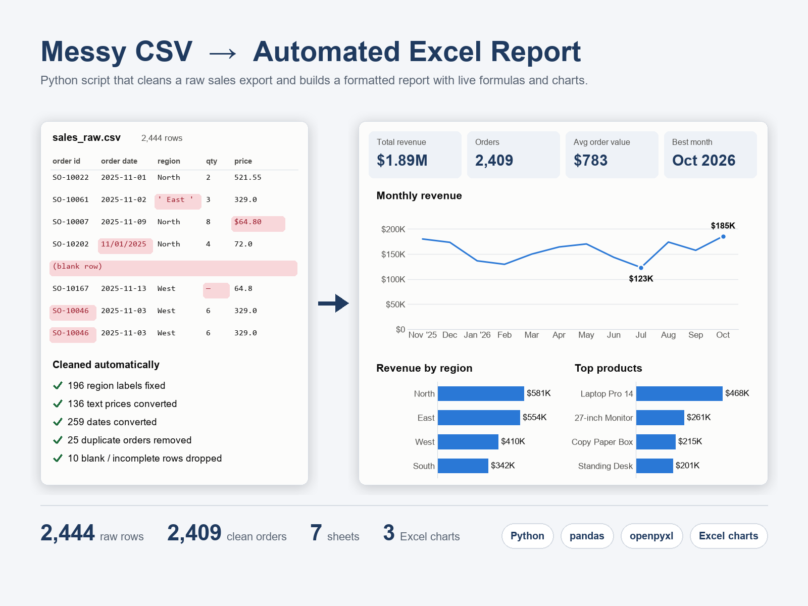

# Messy CSV → Automated Excel Sales Report

A Python script that takes a raw sales export (CSV), cleans it, and builds a
ready-to-share Excel report with KPIs, summaries and native Excel charts — in one
command instead of an afternoon of manual work.



## What it does

**1. Cleans the data** and logs every fix:

| Problem in the raw export | Fix |
|---|---|
| Blank lines | removed |
| Region labels like `north`, `EAST`, `" West "` | standardised to `North`, `East`, `West` |
| Prices typed as text, e.g. `"$1,299.00"` | converted to numbers |
| Mixed date formats (`2026-03-14` and `03/14/2026`) | parsed into real dates |
| Rows with a missing quantity, price or date | dropped |
| Duplicate orders | removed |

**2. Builds the report** (`output/sales_report.xlsx`):

| Sheet | Contents |
|---|---|
| **Dashboard** | Total revenue, orders, average order value, best month, top region + 3 Excel charts |
| **Monthly** | Revenue, orders, average order value and month-over-month change |
| **By Region** | Revenue, orders and share of revenue per region |
| **By Product** | Units sold, revenue and share per product, ranked |
| **By Rep** | Orders, revenue and average order value per sales rep |
| **Clean Data** | The cleaned orders, with filters and a revenue formula per row |
| **Data Quality** | What was fixed or removed, and how many rows |

Every summary is a **live Excel formula** (`SUMIFS`, `COUNTIFS`, `INDEX/MATCH`), so the
report stays correct if someone edits the data directly in Excel.

## Run it

```bash
pip install -r requirements.txt
python build_report.py --input data/sales_raw.csv --output output/sales_report.xlsx
```

```
Rows in raw file                                    2,444
Blank rows removed                                      4
Region labels standardised                            196
Prices converted from text (e.g. "$1,299.00")         136
Dates converted from MM/DD/YYYY                       259
Rows dropped (missing date, quantity or price)          6
Duplicate orders removed                               25
Clean rows in report                                2,409

Revenue 1,885,908.08 across 2,409 orders -> saved output\sales_report.xlsx
```

To regenerate the sample data: `python generate_sample_data.py`

## Adapting it

The cleaning steps and report sheets map directly to common requests — weekly or
monthly sales reports, inventory summaries, CRM exports. All cleaning happens in
`clean()`, so pointing the script at a different export mostly means mapping its
column names there. It can also be scheduled to run automatically or adapted to
read from Excel files or Google Sheets.

## Files

| File | Purpose |
|---|---|
| `build_report.py` | Cleans the data and builds the report |
| `generate_sample_data.py` | Creates the messy sample export |
| `data/sales_raw.csv` | Sample input (2,444 rows) |
| `output/sales_report.xlsx` | Generated report |

All names and figures in the sample data are fictional.
